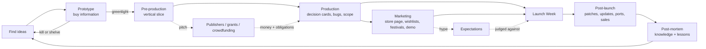

# 01 — Vision, Pillars & Core Loop

## 1. Fantasy and tone

The game goes from **personal** to **institutional** without losing the human part.

- **Early (bedroom):** intimate and scrappy. Your savings, your rent, your laptop fan screaming during builds, your first $3.99 sale, your first one-star review.
- **Middle (small team):** human. Your first hire has a name and a personality. You remember the day you signed the office lease and the week you almost couldn't make payroll.
- **Late (studio):** strategic. You manage a portfolio of projects, a franchise, a publishing label and investors, but the stories are still about people: the lead who left for a rival and came back, the creator who championed your games for a decade.

**Tone:** grounded, warm, dryly funny, and honest about the industry (crunch, predatory contracts, luck, burnout) without cynicism. Be realistic wherever realism creates decisions. Abstract wherever realism would only create tedium.

**Signature emotional beats** the systems must be able to produce:
- The first sale.
- The first brutal review that is *right*.
- The first hire.
- The first layoff.
- A launch day that goes wrong.
- A launch day that goes viral.
- Beating a rival.
- Your publisher cancelling your game.
- Your first award.
- The sequel nobody wanted.
- Buying back your own IP.

## 2. Pillars

| Pillar | Meaning | How it's protected |
|---|---|---|
| **Every dollar and every hour matters** | Scarcity drives decisions. Early on money and hours are scarce, later talent and attention. | Tight early economy, validated in 13. Costs scale with success. The founder's hours never stop being finite. |
| **Success is learned** | The player improves by understanding how systems interact. Luck exists but doesn't decide a careful career. | Consistent rules. Estimates that sharpen with knowledge (17). Post-mortems that explain outcomes. Heavy-tailed luck only on top of solid fundamentals. |
| **Everything is connected** | Every choice ripples into at least two systems, with at least one upside and one shadow. | Design rule 5 ("every gain has a shadow"). The cause-and-effect chains in 19. No isolated upgrades. |
| **Stories over spreadsheets** | Named people with hidden traits, rivals, publishers and creators with memories. Consequences return months later. | Event chains (14). The Promises ledger (09). Relationship memory. Reputation tags. |
| **Readable depth** | Lots of information, layered as glance → inspect → analyze. | Every number has a "Why?" breakdown (18). Uncertainty is drawn as ranges, not hidden. |

## 3. The decision audit

The brief's key question is **"What meaningful decision is the player making here?"** Every system in this document must answer it.

| System | The recurring decision | Why it's hard |
|---|---|---|
| The day (02) | How do I spend this morning, afternoon and evening? | Money now versus progress versus audience versus rest. Overwork compounds into burnout. |
| Freelancing (03) | Which gigs, at what rate, and how many hours? | Pays rent and builds your main skill, but steals time from your game and doesn't build your audience. |
| Ideas (04) | Which concept deserves the next 1–3 years? | Trends move, estimates are uncertain, and passion projects aren't always marketable. |
| Prototyping (04) | How much certainty do I buy before committing? | Every question answered costs weeks. Skipping them risks funding a doomed concept for a year. |
| Concept parameters (05) | Genre, style, scope, engine, platforms, price. | Each choice trades cost against audience against expectations against performance. |
| Features (05) | What goes in, and what gets cut? | Appeal and virality versus complexity, bugs, running costs and scope creep. |
| Decision cards (05) | Quality versus time versus money, many times per project. | Outcomes are uncertain, and cheap choices create technical debt that is paid later. |
| Assets and outsourcing (06) | Make, buy, hire or outsource? | Speed and quality versus originality, consistency, control and cash. |
| Hiring (07) | Who, which role, how senior, where, and when? | Productivity versus burn rate, onboarding drag, hidden traits and span of control. |
| Team management (07) | Crunch, raises, promotions, conflicts, layoffs. | Short-term output versus morale, loyalty, reputation and turnover. |
| Infrastructure (08) | Which tool, machine, room or office, and when? | Each one solves a specific problem at a specific scale, but adds upkeep or a lease. |
| Marketing (09) | Which channels, what content, whom to pitch, how much hype? | Hours and money versus reach. Hype raises expectations. Results are heavy-tailed. |
| Store and wishlists (10) | When to open the page, which tags, which festival, what demo? | One Next Fest per game. A bad demo hurts. Wishlists go stale. |
| Launch (10) | Date, price, discount, delay or ship? | Competition windows, runway, quality risk, promises made. |
| Post-launch (11) | Fix, expand, port, discount, or move on? | Every week spent here is a week not spent on the next game. Abandoning a game hurts trust. |
| Publishers (12) | Sign, negotiate, or walk away? | Funding and services now versus revenue share, IP, deadlines and control later. |
| Finance (13) | Borrow, sell equity, cut costs, or gamble? | Runway versus ownership versus risk. |
| Research (15) | Which capability should my people build instead of the game? | Opportunity cost is real. Some capabilities have upkeep. Some can be bought. |
| Growth (16) | When to scale up, and when to stay small? | Bigger teams make bigger games but need hits to survive. |

### Redesigns: where the brief's version failed the test

| As written in the brief | Problem | Redesign in this GDD |
|---|---|---|
| Hardware increases productivity | "Always buy the best as soon as affordable" isn't a decision. | Hardware matters only for specific work (3D builds, bakes, device testing). It unlocks capabilities (dev kits enable console certification), costs electricity, can fail, and competes with salaries for money (08). |
| Office levels give bonuses | Linear upgrades turn into "+X% money". | Offices are **space** (desks versus rooms), **location** (talent pool, salaries, grants), **lease commitment** and **culture**. Remote-first is a real alternative (08). |
| Massive research tree | Trees of +5% nodes are chores. | Research is done **by your people** instead of shipping. Nodes unlock options, reveal information or fix scaling problems. Some have upkeep; many can be bought instead of built (15). |
| Skill levels give flat bonuses | Every level is the same choice ("yes"). | Small intrinsic gains per level, but perks **fork** at levels 5 and 9 (pick one of two, permanently). Maxing one skill takes most of a career, so you have to specialize (02). |
| Studio perks as rewards | Passive power creep. | Perks are **earned by patterns of behavior**, and each has a shadow: a recognizable brand raises expectations, and media attention amplifies scandals (15). |
| Post on social media | Degenerates into a spam button. | Posting costs founder hours. Results depend on content type, platform, the game's hook, cadence and fatigue, with heavy-tailed outcomes. Attribution is invisible without tools (09). |
| Achievements, controller support, cloud saves | Not decisions. Everyone includes them. | Treated as **hygiene features**: cheap, but missing ones cause specific review complaints and block badges (Deck Verified) or console certification. They become a decision only under crunch (05). |
| Soundtrack sales | Trivial extra revenue. | Tied to the **composer contract** (buyout versus royalty, and who owns the soundtrack rights) and to audio quality. It becomes a franchise asset (11). |
| Merchandise | Free money. | Needs brand strength. Print-on-demand (low margin, no risk) versus bulk inventory (high margin, unsold-stock risk) versus a licensing partner (hands-off, less control) (11). |
| Random industry events | Pure RNG feels unfair. | Events are **conditioned on your state and choices**, foreshadowed when possible, always offer choices, and are rarely purely good or bad (14). |
| Employee stats | Just numbers to compare. | Hidden **traits** revealed over time mean hiring under uncertainty. Stats interact, for example a creative employee gets bored on sequels (07). |
| Virality | Jackpot RNG. | A **buzz cascade** driven by knowable traits (streamer appeal, clip-ability, genre match). The player can improve the odds but never guarantee them (09). |
| Wishlists | A number that goes up. | **Velocity** feeds store algorithms. Wishlists **go stale**. Sources are attributed only with tools. Thresholds matter (10). |
| Localization | A checkbox. | Per-language market size **by genre**, text-volume cost, translation quality risk, and launch-versus-later timing (11). |

## 4. Resources and exchange rates

The game is a web of **converters** between currencies. No converter is strictly better than another, and the rates **change** as the studio grows. That change is what drives progression.

| Resource | Earned by | Spent on | Notes |
|---|---|---|---|
| **Money** | Sales, gigs, contracts, deals, grants, loans, equity | Everything | Cash that's owed to you but not yet paid is shown separately. Platform payouts lag by ~30 days. |
| **Founder hours** | 21 blocks per week (4 hours each) | Development, gigs, marketing, networking, learning, management, rest | Never stops being finite. Late game, management overhead consumes it unless you delegate. |
| **Team capacity** | Employees and contractors (person-weeks) | Projects, research, contracts, support | Reduced by onboarding, coordination overhead, burnout and morale. |
| **Knowledge** | Shipping, prototyping, research, playing games, analytics, post-mortems | Narrower estimates, better bets | Market knowledge **decays**. Craft knowledge persists. |
| **Audience** | Content, festivals, influencers, press, launches | Launch sales, crowdfunding, Early Access, word of mouth | "Owned" audience (mailing list, followers) carries between games. Fans have **genre affinity**. |
| **Reputation and trust** | Quality, kept promises, fair treatment, awards | Leverage in deals, hiring, press, resilience | Five dimensions plus behavior tags (14). |
| **Morale and energy** | Rest, success, fairness, recognition | Output quality and speed | Shared model for the founder and employees. |
| **Relationships** | Events, collaborations, favors, time | Introductions, info, coverage, deals | Decay without contact (14). |

**The exchange rate is the game.** At freelance skill 2, one of your hours earns about $14. A contractor costs about $33 per hour of equivalent output. So you do your own art, badly. At skill 6 your hour earns about $40, and outsourcing art becomes rational. Nobody tells the player this. The Finance and Project screens make it discoverable. The same logic later applies to the founder's attention: a founder hour spent negotiating a publisher deal is worth more than a founder hour spent coding.

## 5. Time model

| Unit | What happens |
|---|---|
| **Slot** (play unit) | A morning, afternoon or evening: one activity, spent by the player. Work is played as a minigame. |
| **Day** (simulation tick) | Ends when the player sleeps: sales accrue, deadlines are checked; the next morning brings payments and mail. |
| **Week** | Burnout and morale settle on Sunday night; new gig offers on Monday; sprint reports, wishlist deltas. |
| **Month** (financial unit) | Rent and salaries on the 1st, platform payouts for the month before last, the monthly report. |
| **Quarter** | Estimated tax, investor reports, publisher milestone checkpoints. |
| **Year** | Annual tax, awards season, reviews of salaries and leases, Gamedoor employer ratings. |

- **No clock.** Time moves only when the player spends a slot or goes to sleep (02 §4). There is nothing to pause or speed up: decisions arrive as mail in the morning or right after a session, and wait for the player.
- **The calendar is real.** Months matter:
  - Vapor seasonal sales: spring (March), summer (late June to July), autumn (November) and winter (late December).
  - Next Fest: February, June, October.
  - DevCon (March), Summer Showcase (June), PlayExpo (August), Golden Controllers (December), Indie Excellence Awards (March).
  - Ad prices spike in Q4. November is crowded with AAA releases.
- **Length:** the main arc is ~12 in-game years, or about 20 hours for a typical player. The game continues as a sandbox afterward.
- **Pacing target (real time):** an early day takes 1–3 minutes (two minigames and a few choices), so the first Tiny game ships within the first hour and an early month takes 45–60 minutes. Once there are employees, they work on their own and the founder's slots go to management and deals (07), so later months pass faster.

## 6. Loops at four scales

### 6.1 The day (early game): Choose → Play → React
1. **Choose.** Spend the morning, afternoon and evening: build a feature, work a gig, post, research, learn or rest.
2. **Play.** Work is a short minigame: Wire It Up for building a feature, a skill game for each kind of gig. How well you play scales the session.
3. **React.** Mail arrives in the morning and after sessions: a client adds scope, a post goes semi-viral, a laptop fan dies, a jam is announced. Then sleep.

### 6.2 The project (6–36 months)

Each project has its own arc: hope → grind → doubt (the "trough of sorrow" around 60% done) → crunch or delay → launch climax → aftermath → lessons.

### 6.3 The studio (years)
**Capabilities** (people, tech, audience, reputation, money) → **bigger, better-informed bets** → **new scale problems** (payroll, coordination, expectations, investor pressure) → **new capabilities** that solve them → repeat. Each studio tier changes which problems dominate (see 16).

### 6.4 The career (meta)
Tiers, player-chosen **Ambitions**, a studio **History** log that records every release and crisis, **scenarios** and **backgrounds** for replay, and optional **Legacy** unlocks when you retire or restart (16).

## 7. What a session looks like

| Tier | A typical 60–90 minute session | Dominant decisions |
|---|---|---|
| Bedroom Developer | 4–8 in-game months. Plan weeks, juggle gigs, finish a tiny game, open a store page, make first posts, attend a jam. | Hours versus money, which gig, which idea, whether to ship now. |
| Small Indie Team | 3–5 months. First hires, a real project in production, decision cards, first publisher pitch, Next Fest. | Who to hire, what to cut, whether to sign, runway. |
| Established Studio | 2–4 months. A launch or a milestone, the office move, post-launch support, the start of a franchise. | Portfolio timing, team health, the post-launch roadmap. |
| Successful Studio | 2–3 months. Two teams, delegation, bigger deals, awards, rivals. | Where the founder spends attention, risk balance, culture. |
| Major Independent | 1–3 months. Portfolio, publishing label, investor or board relations, franchise health. | What to bet the studio on, independence versus exit. |

## 8. Keeping it from getting repetitive (summary)

The full strategy is in 16. The short version:
1. **Problems change with scale.** Each tier retires some decisions through delegation or automation and introduces new ones.
2. **The market moves.** Trends, saturation, ad costs, platform algorithms and graphics expectations drift, so formulas decay.
3. **Delegation climbs the ladder.** Leads resolve decision cards in their own style. The player sets policy instead of clicking.
4. **Projects differ in kind,** not only in size: a narrative game, a live multiplayer game, a port contract and a mobile test each exercise different systems.
5. **People and rivals** generate stories. Event chains remember what you did.
6. **Launches are climaxes.** Crises are set pieces.
7. **There's always another goal:** short objectives, tier milestones and self-chosen Ambitions.

## 9. Mechanics added beyond the brief

| Added mechanic | Why it earns its place | Doc |
|---|---|---|
| **Three slots a day**, each spent by hand | Makes "money now versus game later" a concrete choice several times a day. | 02 |
| **Founder burnout, morale and money anxiety** | Crunch becomes a personal decision long before employees exist. | 02 |
| **Forked skill perks** (levels 5 and 9) | Skill-ups become identity choices instead of stat bumps. | 02 |
| **Backgrounds** | Replayable starts built on the same $5,000 premise. | 02 |
| **Game jams** | A cheap, high-variance source of ideas, collaborators and luck. | 03 |
| **Co-founder option** | Equity versus salary versus control, and a relationship that can break. | 07 |
| **Grants and regional tax relief** | Non-dilutive money that comes with strings, like real indie funding. | 03 |
| **Knowledge system** (genre, market, tech, audience) | "Learning the systems" becomes visible progression. | 17 |
| **Post-mortems and Lessons** | Failure converts into permanent improvement. | 17 |
| **Estimate calibration** (the planning fallacy) | New studios underestimate. Experience fixes it. | 05 |
| **Technical debt** | Shortcuts have a delayed cost, which gives rewrite decisions real stakes. | 05 |
| **Playtest findings** | Turns quality into specific, prioritizable problems. | 05 |
| **Hygiene versus differentiator features** | Separates "expected" features from "exciting" ones. | 05 |
| **Management overhead and Brooks's law** | Hiring isn't linear. Leads and producers matter. | 07 |
| **Hidden employee traits** | Hiring under uncertainty. Stories. | 07 |
| **Studio culture policies** | Crunch, remote, profit share, 4-day week and hiring bar as strategic identity. | 07 |
| **Studio location and remote work** | A real strategic axis: talent pool versus cost versus cohesion. | 08 |
| **Problem-before-solution upgrades** | Tools become desirable because the player felt the pain first. | 08 |
| **Owned versus rented audience; fan genre affinity** | Switching genres costs you part of your audience. | 09 |
| **Promises ledger** | Public commitments boost hype now and become obligations later. | 09 |
| **Hook clarity and press story angles** | Marketability becomes a property you design, not a dice roll. | 09 |
| **Buzz cascade virality** | Virality emerges from traits and coverage, not a lottery. | 09 |
| **Release calendar and launch-window competition** | Launch timing becomes strategy. | 10 |
| **Launch Week live mode** | A climactic, interactive set piece every release. | 10 |
| **Refund window** | Short games and buggy launches bleed refunds. | 11 |
| **Composer contract rights** | Makes soundtracks a real decision. | 11 |
| **Hidden contract clauses and legal review** | Paying for information before signing. | 12 |
| **Payout lag and cash-flow forecast** | "Rich on paper, broke in the bank" crises. | 13 |
| **Incorporation milestone** | Unlocks investors, grants and publisher contracts, and adds admin. | 13 |
| **Industry network (contacts)** | Relationships as a resource that decays without care. | 14 |
| **Graphics-expectation drift** | Realistic art ages fast; stylized art ages slowly. | 14 |
| **Publishing label** (late game) | Turns the early publisher system around and makes it your problem. | 15, 16 |
| **Studio History and Legacy** | Every playthrough leaves a readable story. | 16 |
