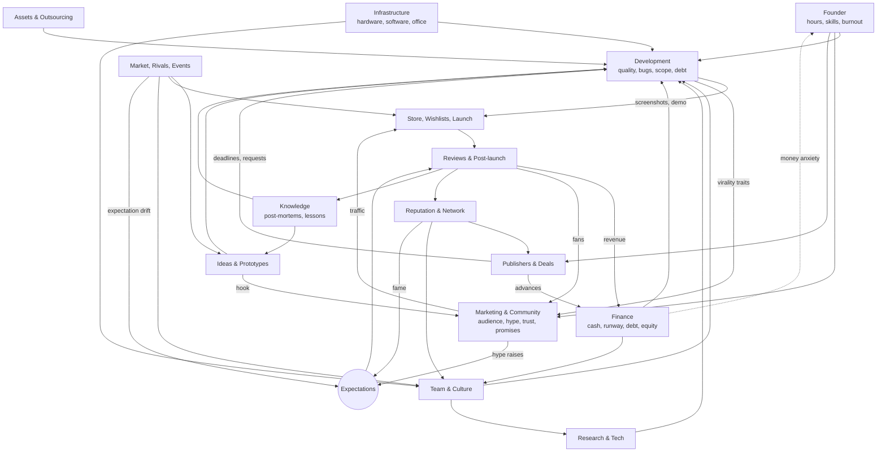

# 19 — System Interactions

The brief's most important requirement is that **every system connects to other systems.** This document maps the connections: the big picture, the cause-and-effect chains (each with an upside *and* a shadow), the feedback loops that create momentum and stop it, a sample 12-year story, and a checklist for adding new mechanics.

## 1. The big map

## 2. Cause-and-effect chains

Each chain has an **upside** and a **shadow**. The first two are the brief's own examples.

| # | Choice | Upside chain | Shadow chain |
|---|---|---|---|
| 1 | **Hire a better artist** | Better graphics → better screenshots and capsule → **higher store conversion** → more wishlists → stronger launch | **Higher salary → higher burn → financial pressure.** Wants a Pro seat and tools. You can only hire well if someone can *judge* art (founder Art or an Art Director). |
| 2 | **Add multiplayer** | Bigger market → **better streamer appeal** → more virality | **Longer development → a network programmer is needed → server costs → more bugs** (very high risk) → dependence on player population (the dead-game spiral) |
| 3 | Choose realistic art | High visual ceiling → screenshot pop → trailer quality | Art ×2.5, a workstation and render server, heavy performance load (painful Nimbus port), **ages fastest**, common assets bring asset-flip risk |
| 4 | Buy popular asset packs | Faster development → earlier launch → more runway | Asset-flip index → Innovation −, "asset flip" reviews, store conversion −15%, a studio tag |
| 5 | Crunch before Next Fest | Demo ready on time → festival wishlists | Bugs ×1.7 in the demo (a bad demo reduces interest). Burnout → lower output afterward. Habitual crunch → "Crunch Studio" → turnover → bus-factor risk. |
| 6 | A big showcase trailer | Hype → wishlists → Popular Upcoming → launch visibility | **Expectations rise** → a score penalty if you underdeliver → "overhyped" → refunds |
| 7 | Promise features (roadmap, stretch goals) | Trust, hype and crowdfunding money now | Obligations → scope creep → cuts become broken promises → trust − → tags |
| 8 | A big publisher advance | Bigger team, marketing and ports → higher quality and reach | Revenue share, milestones (crunch risk), **IP ownership** (sequels may not be yours), creative requests |
| 9 | Epoch exclusivity | Guaranteed money → runway (insurance) | Backlash (a broken promise to backers) → review bomb when it reaches Vapor → stale Vapor wishlists |
| 10 | Hire fast before a deadline | More capacity | Onboarding (40% productivity), seniors' mentoring time, coordination overhead → **a net short-term slowdown** (Brooks's law), plus higher burn |
| 11 | Move into an office | Morale, recruiting appeal, chemistry, focus rooms | Lease commitment → fixed costs during a flop; people who won't relocate |
| 12 | Freelance more | Rent paid, main skill up, higher rates | Less time on your game → later launch → trend drift, wishlist staleness; breadth skill stagnates |
| 13 | Enter a game jam | A Jam-proven idea + a teammate you *really* know → a co-founder or first hire | Weekend burnout; co-founder equity and conflict risk |
| 14 | Transparent devlogs | Trust → crowdfunding, kinder reviews, resilience | Founder hours. Transparency about money problems is **visible to publishers** and lowers your leverage. |
| 15 | Mod support | UGC → longevity and virality → a long tail | 6 pw + complexity + security bugs; conflicts with console crossplay policies |
| 16 | Accessibility suite | Wider audience + press + awards + grant eligibility | Development time. (A rare "almost always worth it" feature. The decision is *when*.) |
| 17 | Documentation culture | Lower bus-factor risk → faster onboarding → poaching hurts less | 2% of team time, forever |
| 18 | Early Access | Revenue and feedback → findings fixed → a better 1.0 | Permanent first impressions; update-cadence obligations; EA fatigue |
| 19 | Make a sequel | A built-in audience + reusable tech → cheaper, lower risk | Inherited tech debt; expectations = previous + more; fatigue; creative morale −; fan affinity locks you into the genre |
| 20 | Win an award | Sales bump, press, recruiting, publisher interest → better deals and talent | Expectations up; "Indie Darling" backlash if you then take VC money; credited staff get poached |
| 21 | Take VC money | Big money → multiple teams → scale | Board KPIs → pressure toward live service and monetization → trust risk; dilution → loss of control → founder-removal risk |
| 22 | Keep the cheap laptop on a 3D project | Money saved | ~20% of hours lost to builds; no backups → *the laptop dies* → lost work (problem → solution: backups and source control) |
| 23 | Switch genres | A new audience, Innovation +, creative morale + | Only part of your fans follow (affinity). Genre knowledge starts low: quality risk, wider estimates. |

## 3. Interaction matrix

**Row → column** means "the row system changes the column system". ● = strong, ○ = weak.

| → | FND | FIN | IDEA | DEV | AST | TEAM | INFR | MKT | STORE | POST | PUB | REP | WORLD | RES | KNOW |
|---|---|---|---|---|---|---|---|---|---|---|---|---|---|---|---|
| **Founder** | | ● | ○ | ● | ○ | ● | ○ | ● | ○ | ○ | ● | ○ | | ○ | ● |
| **Finance** | ● | | | ● | ● | ● | ● | ● | ○ | ○ | ● | ○ | | ○ | |
| **Ideas** | | | | ● | | | | ● | ● | | ○ | | ○ | | ○ |
| **Development** | ○ | ● | | | | ● | | ● | ● | ● | ● | ● | ○ | ○ | ● |
| **Assets & Outsourcing** | | ● | | ● | | | | | ○ | ○ | | ○ | | | ○ |
| **Team** | ○ | ● | ○ | ● | | | | ○ | | | | ● | | ● | ○ |
| **Infrastructure** | ○ | ● | | ● | | ● | | | | ○ | | | | ○ | ● |
| **Marketing & Community** | ○ | ○ | ○ | ○ | | | | | ● | ○ | ● | ● | ○ | | ○ |
| **Store & Launch** | ○ | ● | | | | ○ | | ○ | | ● | ○ | ○ | | | ● |
| **Reviews & Post-launch** | ○ | ● | ○ | ○ | | ○ | | ● | | | ○ | ● | ○ | | ● |
| **Publishers** | ○ | ● | | ● | | ○ | | ● | ○ | ● | | ○ | | | ○ |
| **Reputation & Network** | | | | ○ | ○ | ● | | ● | ○ | ○ | ● | | | | ○ |
| **World** (market, rivals, events) | ○ | ○ | ● | ○ | | ○ | | ○ | ● | ○ | ○ | ○ | | | ○ |
| **Research** | | ○ | | ● | ○ | ○ | ○ | ○ | ○ | ○ | ○ | | | | ● |
| **Knowledge** | ○ | | ● | ● | ○ | ○ | | ○ | ○ | | ○ | | | | |

*Every system both affects and is affected by at least four others. That coupling is the design goal, and it's also why the simulation core must be data-driven and testable (20).*

## 4. Feedback loops

**Reinforcing loops** (momentum):

| Loop | Mechanism |
|---|---|
| R1 Audience flywheel | Release → fans (owned audience) → more wishlists next time → bigger launch → more fans |
| R2 Reputation flywheel | Quality → Developer Reputation → press, creators, better publisher terms → more resources → quality |
| R3 Talent flywheel | Success → employer appeal → better hires → better games → success |
| R4 Knowledge flywheel | Ship → post-mortem → knowledge → better bets → ship |
| R5 Buzz cascade | Coverage → buzz → more coverage (09) |
| **R6 Money-anxiety spiral** (a death spiral) | Low runway → burnout → lower output → later launch → lower runway |
| **R7 Dead-game spiral** | Fewer players → longer queues → negative reviews → fewer players |
| **R8 Crunch spiral** | Crunch → burnout and bugs → delays → more crunch |

**Balancing loops** (limits):

| Loop | Mechanism |
|---|---|
| B1 Expectations | Success → fame and hype → a higher bar → harder to impress |
| B2 Costs of scale | Growth → salaries, rent, overhead, coordination |
| B3 Saturation | A hot trend → clones → saturation → lower returns |
| B4 Franchise fatigue | Each sequel → more fatigue → lower conversion |
| B5 Poaching | Star staff → visibility → rivals poach them |
| B6 Staleness | Time → wishlist decay; Market Knowledge decay |
| B7 Trust erosion | Over-promising → obligations → broken promises |

**Designer's note:** the R loops create the satisfying "things are finally working" momentum. The B loops keep a single hit from ending the challenge. The three death spirals (R6–R8) are where failure stories come from, and each has explicit exits: crisis options (16), vacations and sabbaticals, scope cuts, delays, bots and crossplay, a free weekend.

## 5. A sample playthrough (emergent, not scripted)

- **Year 1.** You quit your job with $5,000 and settle into balanced weeks: 20 hours of GigGrid bug-fixing at ~$15/hour, 22 hours on your game, 6 on marketing.
  - **March:** at a 72-hour jam you team up with **Priya**, a programmer. The jam reveals her traits: *Perfectionist, Mentor*. Your horror-fishing prototype *Tidewatch* places #38. A GIF of its lighthouse turning gets 60k views on Chirp, and a **Viral Hook** is discovered.
  - **May:** your tiny game *Paper Moths* ships at $3.99. It sells 212 units, about $490 net. The post-mortem gives you **Hook First** and reveals you ran 38% over your estimate.
  - **August:** the laptop dies and there was no backup. You lose 2 weeks and buy a NAS and source control *(problem → solution)*.
  - **October:** you greenlight *Hollow Tide*, the jam idea at Small scope, and open its store page.
- **Year 2.**
  - **February:** Next Fest with a short, hook-first demo brings +3,800 wishlists. A 40k-subscriber creator streams it, and buzz rises.
  - **April:** runway is down to 5 weeks. You start a Patronly ($180/month) and apply for a prototype grant (~30% odds).
  - **June:** the grant is approved. It requires incorporation. Priya joins as **co-founder** (25%, vesting).
  - **October:** Crimson Anvil offers $120k for a Medium expansion with consoles: a 40% share and sequel first refusal. A **legal review ($2,500)** finds marketing recouped at 1.25×. You trade away console rights to remove it, and sign.
- **Year 3.**
  - You hire Sam, a junior artist. The team slows down for 6 weeks (Brooks's law), then the art bottleneck clears.
  - **October:** *Hollow Tide* launches (horror, in October) with **14k wishlists** and lands at **91% Very Positive**. A crash on AMD cards is hotfixed within 36 hours of Launch Week.
  - The post-mortem teaches **Test on Target Hardware**. A missed "Nimbus by Christmas" promise costs trust.
- **Years 4–5.**
  - A small office with 6 people. The Nimbus port ships through the publisher.
  - *Hollow Tide* wins **Excellence in Audio**, earning the Media Attention perk. Expectations rise.
  - Rival **Brightwater Games** (a Rising Star) announces a horror-fishing game 6 months before your sequel. You **differentiate** (co-op and a new biome) and announce later. They launch buggy, and their audience comes looking for yours.
- **Years 6–8.**
  - The sequel *Undertow* ships. Priya's **Personal Passion** idea, a cozy spin-off called *Lantern Fields*, gets a second team.
  - Your horror fans mostly don't follow (genre affinity), but a pettable axolotl goes viral on Clipz, and the cozy audience finds it on its own.
- **Years 9–12.**
  - A VC offers $6M for 25%. You choose an **Axis Pass deal** and your Ambition *Stay independent*, and launch a small publishing label that signs two jam teams.
  - A recession lets you hire laid-off AAA veterans at lower salaries, while a partner publisher cancels one of your label's projects.
  - **Year 12:** 42 staff, a three-game franchise, and 1.1M lifetime units of *Hollow Tide*. **Tier 5.**

No step in that story was scripted. Each came from a system described in these documents reacting to the one before it.

## 6. Checklist for adding any new mechanic

1. **What decision does it create?** If none, cut it.
2. **What does it cost?** Money, time, flexibility or an obligation.
3. **Which two or more systems does it touch?** Update the matrix.
4. **What's its shadow?**
5. **What's visible, estimated or hidden,** and how is the hidden part revealed? Update 17.
6. **Does it scale or retire as the studio grows** (delegation, automation)?
7. **Can it produce a story** worth writing into the Studio History?
8. **Does it dominate another option?** Check with the simulator or a spreadsheet before shipping it.
