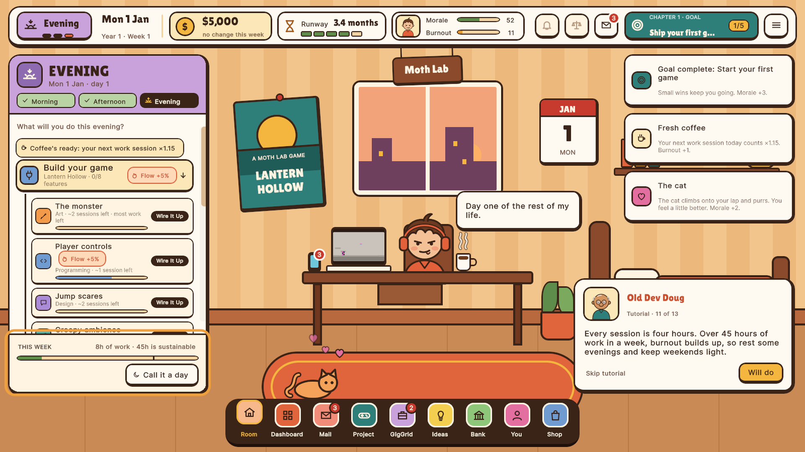
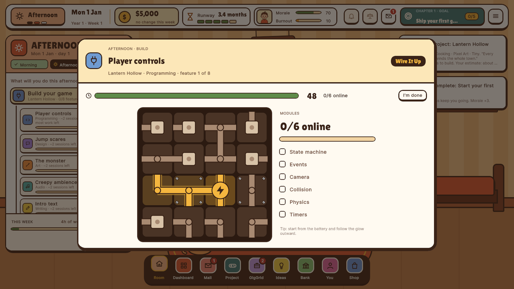
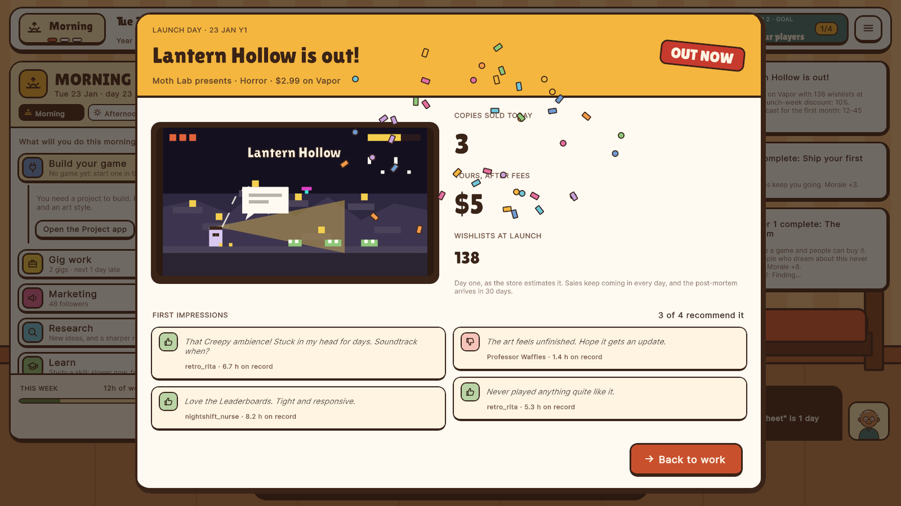
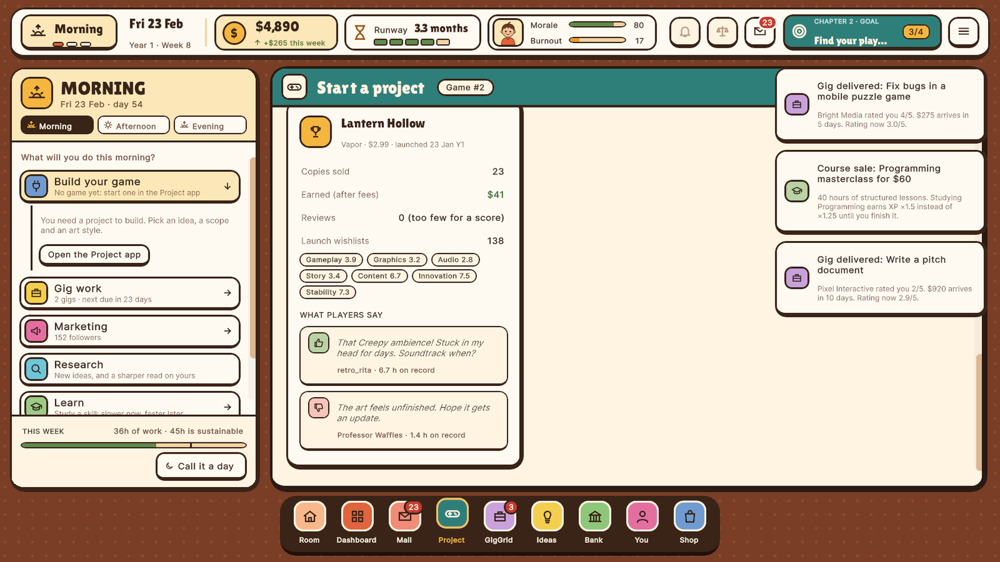

# Ship It! : Indie Studio Simulator

**A cozy but honest management sim about going indie, made in Unity 6.** You start with a bedroom, a laptop, a cat and $5,000. You take freelance gigs to pay the rent, build your game one feature at a time through hands-on minigames, and decide when to quit your day job.

| | |
|---|---|
|  |  |
|  |  |

---

## Gameplay

- **Every hour is yours to spend.** There is no clock. Each day you choose what to do with the morning, afternoon and evening, then go to sleep. The options are Build, Gig work, Marketing, Research, Learn and Rest. Weeks over 45 hours build burnout.
- **Work is played.**
  - Building a feature of your game is **Wire It Up**, a connection puzzle: turn tiles until the flow reaches every module. It dresses up as the work itself: a circuit for code, paint pipes for art, patch cables for audio, level paths for design, and red string on a corkboard for writing.
  - Freelance gigs each have their own minigame: **Bug Squash**, **Pixel Match**, **Typo Hunt**, **Synth Tuner** and **Feedback Sort**.
  - The better you play, the more the session gets done. A relaxed mode turns the timers off.
- **Pay the rent, or chase the dream:**
  - GigGrid freelance work, where pay grows with skill and rating and some clients never pay;
  - rent on the 1st, burnout, a dying laptop, day-job offers, game jams and bankruptcy past the credit limit;
  - "Why?" explanations on every important number.
- **Ship it:**
  - Start a Tiny or Small game from an idea card (genre, scope, art style) and wire up its features.
  - Open a store page, collect wishlists and enter **Next Fest** with a demo.
  - **Launch** with a launch-day show, then play launch week: daily sales, player and critic reviews, hotfixes and posts. Word of mouth carries the reviews into every month of sales after.
  - A day-30 post-mortem shows what players actually saw.
- **The room is a status display.**
  - The laptop shows your game as it grows, from gray boxes and a magenta placeholder hero to real art.
  - Pizza boxes pile up with burnout, and trophies appear when you ship.
  - You can brew coffee and pet the cat.
- Four chapters of goals, 24 achievements, and an Old Dev Doug tutorial.

**Status:** milestone M1, a playable slice of the solo "Bedroom Developer" years from the design.
- The game saves itself and is prepared for Steam: sign-in, 24 achievements and Steam Cloud saves.
- A Steamworks app exists, and the store page text, art, GIFs and trailer are made.
- The full design (21 documents) goes much further: a team, publishers, franchises and more.

## Tech stack

| Area | What it uses |
|---|---|
| Engine | **Unity 6** (6000.0.32f1), 2D |
| UI | **UI Toolkit, built entirely in code**, with a warm "sticker" look in USS (`Styles.uss`, `Theme.tss`). **Painter2D** draws what USS can't. |
| Game rules | Plain C# with no UnityEngine references, deterministic per seed |
| Saving | Autosave a second after every change and on quit, backup recovery, versioned saves; **Steam Cloud** with a conflict prompt |
| Platform | **Steamworks.NET** module: sign-in, achievements, Steam Cloud, an auth ticket for a future server. It compiles only once the package is installed; offline otherwise. |
| Testing | **NUnit**: 71 simulation tests, including bot-driven 2-year balance tests, plus 12 Play Mode tests on the real game |
| Outside Unity | **.NET 8** harness that runs the simulation tests in about 5 seconds and type-checks the Unity layer and the Steam module without opening the editor |
| Design tools | Python economy model (`Design/Tools/economy_sim.py`) for exploring strategies |
| Marketing | Store art rendered from HTML, GIFs cut with ffmpeg from recorded gameplay, and a trailer with music synthesized in Python (`Marketing/Steam/trailer/music.py`) |

## What I built

All of it. The game code is **`Assets/IndieStudio/`**: 90 C# scripts, about 19k lines.

| System | Where |
|---|---|
| The game rules: days and time slots, gigs, projects and features, marketing, store pages, Next Fest, launch week, reviews, the economy, chapters and achievements | `Simulation/` (start at `GameSimulation.cs`; all tunables in `Content/Tuning.cs`) |
| Saves and cloud sync: which copy wins between this computer and Steam Cloud | `Simulation/Core/SaveGame.cs`, `Core/SaveSync.cs`, `Game/Persistence` |
| Unity layer: auto-start, the controller that owns the simulation, the platform and the autosave | `Game/GameBootstrap.cs`, `Game/GameController.cs`, `Game/Platform/` |
| The UI, built in code: the day panel, the tutorial coach, activities, the launch-day show, confetti, achievements | `Game/UI/` (`TodayPanel`, `Coach`, `Activities`, `LaunchShow`, `Celebrate`, `AchievementView`) |
| Six minigames | `Game/UI/Minigames/` (`WireItUp`, `BugSquash`, `PixelMatch`, `TypoHunt`, `SynthTuner`, `FeedbackSort`) |
| Vector drawing with Painter2D | `Game/UI/Drawing/` |
| Steam | `Steam/` (Steamworks.NET), with a fake Steam for tests |
| Tests | `Simulation/Tests/` (rules, full game flows, balance) and `Game/Tests/` (Play Mode) |

The `Game/UI/Drawing/` code draws:
- the cartoon avatar;
- line icons from SVG path data;
- `GamePreview`, your game as it grows, drawn from its genre, art style and progress;
- the cash-forecast chart and the cat.

Outside the Unity project:
- `SimHarness/` holds the .NET test and compile-check projects.
- `Design/` holds the 21-document game design and the economy model.
- `Steam/` has the Steamworks setup and achievement sheet.
- `Marketing/Steam/` has the store page, art sources, GIF pipeline and trailer.

### Code highlights

- **`Simulation/GameSimulation.cs`:** the whole game as plain, deterministic C#. Because nothing in it touches UnityEngine, the same test files run inside Unity and in a 5-second `dotnet test`.
- **Balance tests:** bots play 40 seeds × 2 years for each strategy and fail the build if a change breaks the intended economy:
  - going all-in needs outside money;
  - balanced play survives by a thread;
  - gig-heavy play is safe but slow;
  - keeping a full-time job never finishes a Small game.
- **`Simulation/Core/SaveSync.cs`:** decides which save wins between this computer and Steam Cloud, and puts a real conflict to the player.
- **`Game/UI/Minigames/WireItUp.cs`:** one connection puzzle with five looks, one per discipline. Bigger projects add wobbly tiles.
- **`Game/Tests/`:** a smoke test that:
  - boots the real game and follows the tutorial;
  - plays every minigame and every look of Wire It Up;
  - brews coffee, pets the cat and launches a game;
  - opens every screen.

  Platform tests use a fake Steam: the studio follows you to a second computer, and a conflict asks which studio to keep.
- **`SimHarness/`:** type-checks the Unity layer against the engine DLLs, and the Steam module against a Steamworks stand-in, without the editor.

## Scenes

| Scene | Purpose |
|---|---|
| `Assets/Scenes/SampleScene.unity` | The only scene. The game builds itself at start, so no scene setup is needed. |

## Integrated third-party assets

No Asset Store content. Everything is original except:
- **Lilita One**, a font from Google Fonts under the SIL Open Font License (`Assets/IndieStudio/Game/Resources/IndieStudio/Fonts/`);
- **Steamworks.NET**, which is not included; it is installed separately to switch the Steam features on.

## Docs

- [`PROJECT_README.md`](PROJECT_README.md): the project's own notes, covering how to play, the project layout, how to test, and balance at a glance
- [`Design/`](Design/README.md): the game design document (21 docs) and `Tools/economy_sim.py`
- [`Steam/README.md`](Steam/README.md): Steamworks setup and the achievements sheet
- `Marketing/Steam/store_text.md`: the store page text

## About this repository

This public repository is a **showcase**. It contains the documentation and the **107 source files I wrote** for this project. The complete Unity project, with the store-page material and the Steam setup, is kept in a private repository.

Copyright © Omer Avcioglu (McHunter Studio). **All rights reserved.** Viewing only; see [LICENSE](LICENSE).
